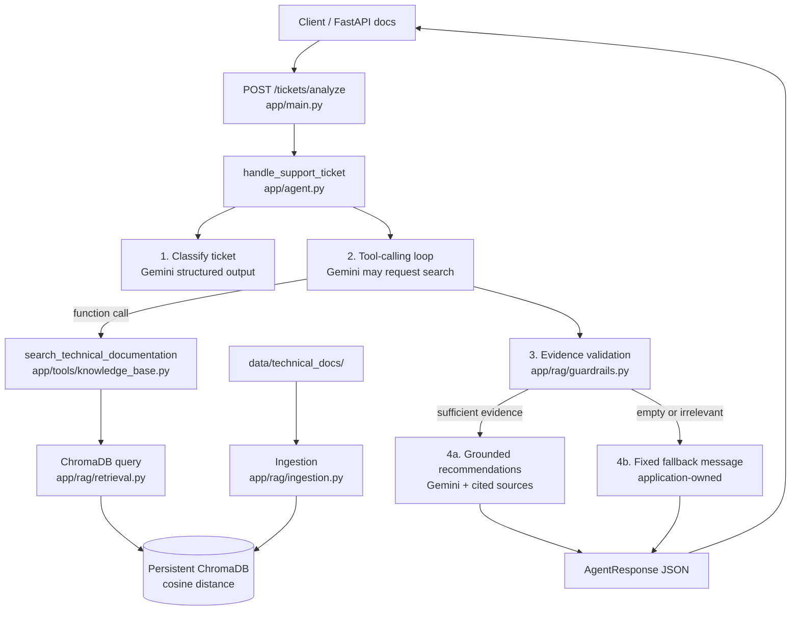

# Agentic Technical Support (RAG)

An MVP technical-support agent that classifies IT tickets, retrieves internal documentation from ChromaDB through Gemini function calling, and returns **evidence-grounded** troubleshooting recommendations — or a **fixed application-owned fallback** when evidence is insufficient.

This project is intended for demonstration and evaluation on a fixed ticket set. Strong results on that set show the intended behaviors work for those cases; they do **not** establish production-level reliability.

## Architecture



### Execution flow

1. **Ingest** Markdown docs from `data/technical_docs/` into a local persistent ChromaDB collection (Gemini embeddings).
2. **Receive** a ticket (`ticket_id`, `description`) via `POST /tickets/analyze` or `handle_support_ticket()`.
3. **Classify** the ticket into `network` | `database` | `authentication` | `application` | `other`, and extract completeness facts (is it a troubleshooting request, which system, which observable symptom) in the same call.
4. **Clarify if needed**: a troubleshooting ticket with no observable symptom gets clarifying questions and stops here, before any search (see [Clarification](#clarification)).
5. **Tool selection**: Gemini may request `search_technical_documentation` in one round. The model does **not** execute Python — the app runs the search. Thanks, staffing, and announcements skip this call because classification already rejected them. The model is not asked to write from the tool result; the host does that in step 7, which avoids a second paid call. A ticket-text embedding is cached and reused when the clarification check and the evidence check search the same text.
6. **Validate evidence** deterministically against the original ticket text: the best match must be close enough *and* stand out from unrelated documents (calibrated thresholds). Absence of retrieval is never treated as sufficient evidence.
7. **Respond** with one of three `outcome` values:
   - `grounded_answer`: adequate evidence → recommendations with source references.
   - `clarification_needed`: the ticket is too vague → `clarifying_questions`, no recommendations.
   - `fallback`: insufficient / irrelevant / missing evidence, or not a troubleshooting request → fixed fallback (no invented procedures).

### Stack

| Layer | Choice |
|---|---|
| Language | Python |
| LLM / function calling / embeddings | Gemini API (`google-genai`) |
| Vector store | ChromaDB persistent local client |
| API | FastAPI + Pydantic |
| Tests / eval | pytest + `evals/run_evaluation.py` |

## Installation and configuration

```bash
python -m venv .venv
# Windows
.venv\Scripts\activate
# macOS/Linux
# source .venv/bin/activate

pip install -r requirements.txt
copy .env.example .env   # or: cp .env.example .env
```

Edit `.env`:

```env
GOOGLE_API_KEY=your_api_key_here
```

Get a key from [Google AI Studio](https://aistudio.google.com/apikey).

Important config knobs (`app/config.py`):

| Setting | Meaning |
|---|---|
| `llm_model` | Gemini model for classification / tools / grounding |
| `embedding_model` | `gemini-embedding-001` |
| `relevance_max_distance` | Max cosine distance of the best match (lower = closer); calibrated `0.3687` |
| `relevance_min_contrast` | Min gap between the best and the `relevance_contrast_rank`-th distinct document; calibrated `0.0442` |
| `relevance_contrast_rank` | Which background document contrast is measured against; calibrated `5` |
| `relevance_candidate_pool` | Chunks retrieved for the ticket text when judging sufficiency; default `15` |
| `min_relevant_chunks` | Minimum relevant chunks required; default `1` |

Never commit `.env`. `.gitignore` excludes `.env`, `.venv/`, and `data/chroma/`.

## Ingest documentation

```bash
python -m app.rag.ingestion
```

- Source: `data/technical_docs/` (network, HTTP errors, database, auth, uploads, IP/VPN, …)
- Index: `data/chroma/` (local, persistent; cosine space)

## Run the API

```bash
uvicorn app.main:app --reload
```

Interactive docs: [http://127.0.0.1:8000/docs](http://127.0.0.1:8000/docs)

Health check: `GET /health`

A browser console for submitting tickets lives in `frontend/`; see [frontend/README.md](frontend/README.md) for how to run it.

### Example — relevant documentation available

Request:

```http
POST /tickets/analyze
Content-Type: application/json

{
  "ticket_id": "T-DB-001",
  "description": "Users cannot connect to the application because the database connection keeps timing out."
}
```

Example successful shape (values vary by model/index):

```json
{
  "ticket_id": "T-DB-001",
  "category": "database",
  "outcome": "grounded_answer",
  "recommendations": [
    "Verify the database connection string and credentials against current secrets.",
    "Test connectivity from the app host with a native DB client.",
    "Check connection pool size versus active connections for exhaustion."
  ],
  "sources": [
    {
      "source": "database_connection_failures.md",
      "doc_id": "database_connection_failures",
      "chunk_index": 0,
      "category": "database",
      "distance": 0.21,
      "excerpt": "..."
    }
  ],
  "clarifying_questions": [],
  "sufficient_evidence": true,
  "fallback_triggered": false,
  "summary": "Documented diagnostics cover credentials, connectivity, and pools. Root cause is not yet confirmed."
}
```

### Example — insufficient evidence (fallback)

Request:

```json
{
  "ticket_id": "T-IRR-001",
  "description": "Kubernetes pods keep CrashLooping after a new sidecars resource quota policy in GKE."
}
```

Application response (deterministic fallback text):

```json
{
  "ticket_id": "T-IRR-001",
  "category": "application",
  "outcome": "fallback",
  "recommendations": [
    "Insufficient supporting documentation was found to provide reliable troubleshooting recommendations. Please review the ticket manually."
  ],
  "clarifying_questions": [],
  "sources": [],
  "sufficient_evidence": false,
  "fallback_triggered": true,
  "summary": "Insufficient supporting documentation was found to provide reliable troubleshooting recommendations. Please review the ticket manually."
}
```

### Example — too vague (clarification)

Request:

```json
{
  "ticket_id": "T-VAGUE-001",
  "description": "It stopped working after yesterday."
}
```

Response (no search is run):

```json
{
  "ticket_id": "T-VAGUE-001",
  "category": "application",
  "outcome": "clarification_needed",
  "recommendations": [],
  "clarifying_questions": [
    "Which system or feature is affected (for example the website, sign-in, VPN, file uploads, or a specific database)?",
    "What exactly happens? Please include the exact error message or code, or describe what you see instead of the expected result.",
    "When did it start, and is it affecting one user, a team, or everyone?"
  ],
  "sources": [],
  "sufficient_evidence": false,
  "fallback_triggered": false,
  "summary": "More detail is needed before documented troubleshooting steps can be recommended. Please answer the questions below."
}
```

CLI / library entry points:

```bash
python -m app.agent
```

```python
from app.agent import handle_support_ticket
from app.schemas import SupportTicket

result = handle_support_ticket(
    SupportTicket(ticket_id="T-1", description="HTTP 504 on checkout")
)
```

## Clarification

Clarification and the documentation fallback are different outcomes because the gap is in a different place:

| Outcome | Where the gap is | Who can close it | Search? |
|---|---|---|---|
| `clarification_needed` | The ticket does not say what happens | The reporter | No, ask first |
| `fallback` | The docs do not cover a specific problem, or it is not a troubleshooting request | A human agent | Yes (or not needed) |

Asking a reporter more questions cannot fill a documentation gap, and searching a ticket that says nothing specific only produces near-random matches.

**Policy** (`app/clarification.py`): a troubleshooting ticket needs clarification when it does not describe an **observable symptom** (error text, a code, or a concrete behavior such as "cannot ping the gateway"). Generic wording ("broken", "not working", "an issue", "errors", "something is wrong") does not count, nor does a phrase that only repeats the system name. A missing system name alone does not trigger clarification when the symptom is specific ("returns 503"), but it is asked about alongside a missing symptom.

**Who decides**: Gemini only *extracts* phrases from the ticket (`TicketCompleteness`, in the classification call). The application decides: a phrase counts only if every word appears in the ticket and at least one word is specific (not a stopword or generic). Paraphrased or invented extractions are therefore ignored.

**Second check before asking**: extraction is one non-deterministic model call, and the lightweight model sometimes drops a symptom the ticket plainly states. E-REL-004 ("Employees cannot resolve internal hostnames after the DNS change…") got no symptom in 3 of 6 identical calls. So before clarifying, if the ticket contains specific words beyond the system name, the host runs one embedding lookup on the ticket text and applies the calibrated sufficiency rule. If one document clearly stands out, the ticket is specific enough and goes through the normal path (`clarification_overridden` in the trace). Vague tickets match many documents weakly and fail this rule. A ticket that only names a system ("The VPN is acting weird") is not re-checked, because the system name alone can match one document strongly.

Check the decision on the labeled calibration tickets (one Gemini call per ticket, no retrieval):

```bash
python -m evals.check_clarification
```

Latest result: [`evals/results/CLARIFICATION_CHECK.md`](evals/results/CLARIFICATION_CHECK.md) — 51/53. All 29 answerable tickets proceed; 9/10 vague tickets get clarification; 13/14 out-of-corpus tickets proceed to the documentation check. The extraction prompt was revised once after a first check on this set (45/53), so the 20-ticket evaluation is the held-out measure.

## Fallback logic

Fallback is owned by the **application**, not by asking Gemini whether it “feels” uncertain.

When Gemini requests a search, the host also retrieves with the **original ticket text** and judges sufficiency on those scores (`app/rag/guardrails.py`). Gemini's rewritten query can add domain words a vague ticket never contained.

```text
best     = cosine distance of the closest document
contrast = distance of the 5th closest distinct document - best

sufficient = retrieval ran
             and best <= relevance_max_distance       # close enough
             and contrast >= relevance_min_contrast   # stands out from the background
```

The two checks catch different failures:

- **Out-of-corpus tickets** (Kubernetes, Terraform, Salesforce) land on unrelated pages at distance ~0.39–0.45. The distance cap rejects them.
- **Vague tickets** ("The application is broken for some users") are *close* to many documents at once (~0.30) but no document stands out. Low contrast rejects them; a distance threshold alone cannot.

### Calibration

The thresholds are fitted, not chosen by hand:

```bash
python -m evals.calibrate_relevance                  # embeds labeled tickets, fits, reports
python -m evals.calibrate_relevance --reuse-features # refit from saved scores, no API calls
```

- Labeled data: `evals/calibration_tickets.json` — 53 tickets (29 answerable, 14 out-of-corpus, 10 vague), kept **separate** from the 20-ticket evaluation so that evaluation stays held out.
- Rule families compared: distance only, contrast only, both (contrast ranks 2–5).
- Objective: an unsafe answer (recommendations from unrelated docs) costs 2, a missed answer (unnecessary manual review) costs 1. Within a family the widest-margin thresholds win; across families, leave-one-out cost decides.
- Results: [`evals/results/CALIBRATION.md`](evals/results/CALIBRATION.md). The previous `distance <= 0.45` rule would have accepted 18 of the 24 calibration tickets that should fall back.

Re-run calibration after changing the corpus, chunking, or embedding model.

Also:

- If Gemini does **not** request retrieval, that is **not** treated as sufficient evidence → fallback path.
- Mentions of a filename alone do not count as grounding; recommendations must follow retrieved text, and citations must come from retrieved evidence.

Fixed message:

> Insufficient supporting documentation was found to provide reliable troubleshooting recommendations. Please review the ticket manually.

## Tests

```bash
pytest tests -q
```

Live Gemini / embedding tests skip unless `GOOGLE_API_KEY` is set.  
Offline suites cover chunking/idempotency helpers, API validation, fallback gates, grounding assembly, and evaluation scoring.

## Evaluation

### Fixed dataset

`evals/support_tickets.json` — **20** frozen tickets:

| Group | Count |
|---|---:|
| Relevant documentation | 10 |
| Insufficient / irrelevant evidence | 5 |
| Ambiguous / underspecified | 3 |
| Should not require retrieval | 2 |

Expectations (`expected_category`, `retrieval_appropriate`, `expected_supporting_documents`, `expected_outcome`) are **not** rewritten to match the agent. Version 1.1 split the old boolean `fallback_expected` into three outcomes (10 `grounded_answer`, 3 `clarification_needed`, 7 `fallback`); the reasoning is in the dataset's `outcome_policy` and `changelog`.

### Behaviors scored (CV claims)

| Behavior | What is checked |
|---|---|
| **Tool selection** | Gemini requests retrieval when appropriate, and avoids it when not (including vague tickets, which should not be searched) |
| **Answer grounding** | For grounded answers, citations overlap expected docs and come from retrieved evidence |
| **Outcome** | The returned `outcome` matches `expected_outcome` and its payload is consistent: recommendations for a grounded answer, questions without recommendations for clarification, the fixed message for fallback. Clarification and fallback are **not** interchangeable. |

The report includes an expected-vs-returned outcome matrix, so a clarification answered with a fallback (or the reverse) is visible at a glance.

### Reproduce

```bash
python -m evals.run_evaluation
python -m evals.run_evaluation --rescore   # re-score saved traces after a scoring change, no API calls
python -m evals.run_evaluation --dataset evals/regression_tickets.json
```

### Regression tickets

`evals/regression_tickets.json` — 16 tickets added after the clarification change, kept in a separate file so the original 20 stay unchanged and before/after results stay comparable. Each ticket has a `regression_target` naming the failure it guards against (a paraphrase of E-REL-004, a generic system with a specific symptom, a system name with no symptom, undocumented tickets that share vocabulary with the docs, an announcement that mentions an outage). Results go to `evals/results/REGRESSION_TICKETS_RESULTS.md`, never to `RESULTS.md`.

The full 20-ticket run needs roughly 50 Gemini requests and the regression set roughly 40. The free tier for `gemini-3.5-flash-lite` allows 500 requests per day; a run stopped by the daily quota does not overwrite the results snapshot.

Writes:

- `evals/results/latest.json`
- `evals/results/latest.md`
- `evals/results/RESULTS.md` (full-suite snapshot)

Offline scoring tests:

```bash
pytest tests/test_eval_scoring.py -q
```

### Results status and limits

See [`evals/results/RESULTS.md`](evals/results/RESULTS.md).

**Limits of this evaluation (read carefully):**

- Success on these 20 tickets demonstrates behavior **on that fixed set**, under the current prompts, models, and threshold.
- It does **not** prove production reliability, coverage of all IT domains, or robustness to adversarial / novel tickets.
- Gemini non-determinism, embedding drift, rate limits, and threshold calibration can change outcomes.
- Latency and API error counts are recorded by the harness as secondary signals only; they are not a substitute for the three core behavior checks.
- Category accuracy is observed in traces but is not the primary CV claim scored by the harness (tool selection, grounding, fallback are).

## Project layout

```text
app/
  main.py              # FastAPI: POST /tickets/analyze
  agent.py             # classify → tools → validate → respond
  schemas.py           # request/response models
  clarification.py     # when a vague ticket gets clarifying questions
  config.py            # settings
  tools/knowledge_base.py
  rag/
    ingestion.py
    retrieval.py
    guardrails.py      # evidence validation + FALLBACK_MESSAGE
data/technical_docs/
evals/
  support_tickets.json       # frozen 20-ticket evaluation (held out)
  regression_tickets.json    # 16 regression tickets, scored separately
  calibration_tickets.json   # 53 labeled tickets for threshold calibration
  calibrate_relevance.py
  check_clarification.py     # clarification decision on the calibration tickets
  run_evaluation.py
  scoring.py
  results/RESULTS.md
  results/CALIBRATION.md
  results/CLARIFICATION_CHECK.md
tests/
```

## Known limitations

- Knowledge base is a small curated Markdown corpus, not a full enterprise wiki.
- Sufficiency thresholds are calibrated on 53 hand-labeled tickets over a 14-document corpus; they carry real sampling error and must be re-fitted for a new corpus or embedding model.
- Contrast assumes one document usually owns a topic. If several documents legitimately cover the same problem, contrast drops for good tickets and the rank needs re-fitting.
- Clarification depends on Gemini extracting the symptom phrase. On the calibration set it still misses some cases: "A GPU driver update broke CUDA" is clarified (no symptom beyond "broke"), and "My team has an access issue" is read as an access request and falls back. The API returns clarifying questions but does not yet carry a conversation, so the reporter's answer must be submitted as a new ticket.
- No authentication, multi-tenant isolation, or ticket-routing/escalation workflow.
- FastAPI surface is demo-oriented (Swagger UI), not a hardened production API.
- Evaluation is case-based and limited; treat results as qualitative proof of mechanism, not as an SLA.

## License / publishing notes

Publish without secrets: keep real keys only in local `.env`. The repo ships `.env.example` with `your_api_key_here` only.
