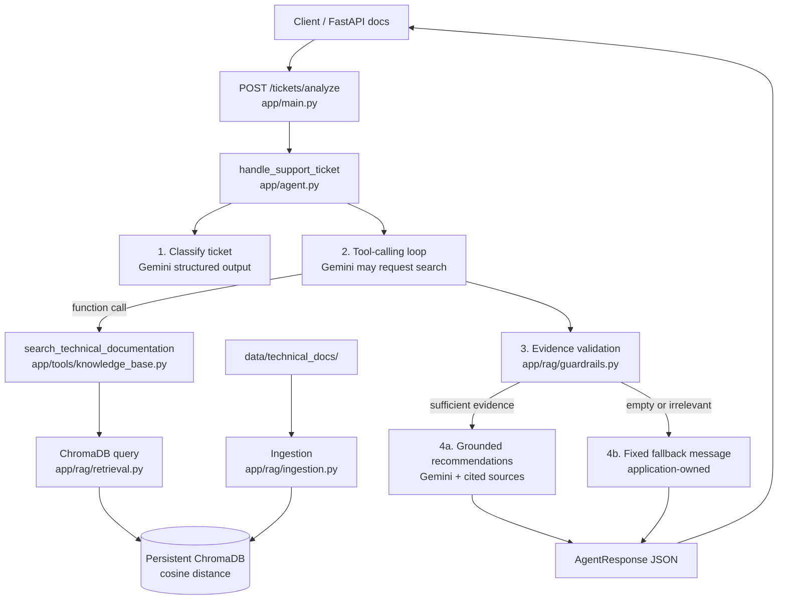

# Agentic Technical Support (RAG)

An MVP technical-support agent that classifies IT tickets, retrieves internal documentation from ChromaDB through Gemini function calling, and returns **evidence-grounded** troubleshooting recommendations — or a **fixed application-owned fallback** when evidence is insufficient.

This project is intended for demonstration and evaluation on a fixed ticket set. Strong results on that set show the intended behaviors work for those cases; they do **not** establish production-level reliability.

## Architecture



### Execution flow

1. **Ingest** Markdown docs from `data/technical_docs/` into a local persistent ChromaDB collection (Gemini embeddings).
2. **Receive** a ticket (`ticket_id`, `description`) via `POST /tickets/analyze` or `handle_support_ticket()`.
3. **Classify** the ticket into `network` | `database` | `authentication` | `application` | `other`.
4. **Tool selection**: Gemini may request `search_technical_documentation`. The model does **not** execute Python — the app runs the search and returns results.
5. **Validate evidence** deterministically (cosine distance threshold). Absence of retrieval is never treated as sufficient evidence.
6. **Respond**:
   - Adequate evidence → grounded recommendations with source references.
   - Insufficient / irrelevant / missing evidence → fixed fallback (no invented procedures).

### Stack

| Layer | Choice |
|---|---|
| Language | Python |
| LLM / function calling / embeddings | Gemini API (`google-genai`) |
| Vector store | ChromaDB persistent local client |
| API | FastAPI + Pydantic |
| Tests / eval | pytest + `evals/run_evaluation.py` |

## Installation and configuration

```bash
python -m venv .venv
# Windows
.venv\Scripts\activate
# macOS/Linux
# source .venv/bin/activate

pip install -r requirements.txt
copy .env.example .env   # or: cp .env.example .env
```

Edit `.env`:

```env
GOOGLE_API_KEY=your_api_key_here
```

Get a key from [Google AI Studio](https://aistudio.google.com/apikey).

Important config knobs (`app/config.py`):

| Setting | Meaning |
|---|---|
| `llm_model` | Gemini model for classification / tools / grounding |
| `embedding_model` | `gemini-embedding-001` |
| `relevance_max_distance` | Cosine distance threshold (lower = closer); default `0.45` |
| `min_relevant_chunks` | Minimum relevant chunks required; default `1` |

Never commit `.env`. `.gitignore` excludes `.env`, `.venv/`, and `data/chroma/`.

## Ingest documentation

```bash
python -m app.rag.ingestion
```

- Source: `data/technical_docs/` (network, HTTP errors, database, auth, uploads, IP/VPN, …)
- Index: `data/chroma/` (local, persistent; cosine space)

## Run the API

```bash
uvicorn app.main:app --reload
```

Interactive docs: [http://127.0.0.1:8000/docs](http://127.0.0.1:8000/docs)

Health check: `GET /health`

### Example — relevant documentation available

Request:

```http
POST /tickets/analyze
Content-Type: application/json

{
  "ticket_id": "T-DB-001",
  "description": "Users cannot connect to the application because the database connection keeps timing out."
}
```

Example successful shape (values vary by model/index):

```json
{
  "ticket_id": "T-DB-001",
  "category": "database",
  "recommendations": [
    "Verify the database connection string and credentials against current secrets.",
    "Test connectivity from the app host with a native DB client.",
    "Check connection pool size versus active connections for exhaustion."
  ],
  "sources": [
    {
      "source": "database_connection_failures.md",
      "doc_id": "database_connection_failures",
      "chunk_index": 0,
      "category": "database",
      "distance": 0.21,
      "excerpt": "..."
    }
  ],
  "sufficient_evidence": true,
  "fallback_triggered": false,
  "summary": "Documented diagnostics cover credentials, connectivity, and pools. Root cause is not yet confirmed."
}
```

### Example — insufficient evidence (fallback)

Request:

```json
{
  "ticket_id": "T-IRR-001",
  "description": "Kubernetes pods keep CrashLooping after a new sidecars resource quota policy in GKE."
}
```

Application response (deterministic fallback text):

```json
{
  "ticket_id": "T-IRR-001",
  "category": "application",
  "recommendations": [
    "Insufficient supporting documentation was found to provide reliable troubleshooting recommendations. Please review the ticket manually."
  ],
  "sources": [],
  "sufficient_evidence": false,
  "fallback_triggered": true,
  "summary": "Insufficient supporting documentation was found to provide reliable troubleshooting recommendations. Please review the ticket manually."
}
```

CLI / library entry points:

```bash
python -m app.agent
```

```python
from app.agent import handle_support_ticket
from app.schemas import SupportTicket

result = handle_support_ticket(
    SupportTicket(ticket_id="T-1", description="HTTP 504 on checkout")
)
```

## Fallback logic

Fallback is owned by the **application**, not by asking Gemini whether it “feels” uncertain.

After retrieval (if any):

```text
if not results or not is_relevant(results):
    return FALLBACK_MESSAGE
```

Where relevance means: at least `min_relevant_chunks` with **cosine distance ≤ `relevance_max_distance`** (lower distance = closer match).

Also:

- If Gemini does **not** request retrieval, that is **not** treated as sufficient evidence → fallback path.
- Mentions of a filename alone do not count as grounding; recommendations must follow retrieved text, and citations must come from retrieved evidence.

Fixed message:

> Insufficient supporting documentation was found to provide reliable troubleshooting recommendations. Please review the ticket manually.

## Tests

```bash
pytest tests -q
```

Live Gemini / embedding tests skip unless `GOOGLE_API_KEY` is set.  
Offline suites cover chunking/idempotency helpers, API validation, fallback gates, grounding assembly, and evaluation scoring.

## Evaluation

### Fixed dataset

`evals/support_tickets.json` — **20** frozen tickets:

| Group | Count |
|---|---:|
| Relevant documentation | 10 |
| Insufficient / irrelevant evidence | 5 |
| Ambiguous / underspecified | 3 |
| Should not require retrieval | 2 |

Expectations (`expected_category`, `retrieval_appropriate`, `expected_supporting_documents`, `fallback_expected`) are **not** rewritten to match the agent.

### Behaviors scored (CV claims)

| Behavior | What is checked |
|---|---|
| **Tool selection** | Gemini requests retrieval when appropriate, and avoids it when not |
| **Answer grounding** | For non-fallback tickets, citations overlap expected docs and come from retrieved evidence |
| **Fallback behavior** | Fallback when evidence is insufficient; recommendations when evidence is adequate |

### Reproduce

```bash
python -m evals.run_evaluation
```

Writes:

- `evals/results/latest.json`
- `evals/results/latest.md`
- `evals/results/RESULTS.md` (full-suite snapshot)

Offline scoring tests:

```bash
pytest tests/test_eval_scoring.py -q
```

### Results status and limits

See [`evals/results/RESULTS.md`](evals/results/RESULTS.md).

**Live full-suite results were not recorded in the publish environment** (no API key / Chroma index available there). After you run the evaluator locally with a key, commit an updated `RESULTS.md` if you want published numbers.

**Limits of this evaluation (read carefully):**

- Success on these 20 tickets demonstrates behavior **on that fixed set**, under the current prompts, models, and threshold.
- It does **not** prove production reliability, coverage of all IT domains, or robustness to adversarial / novel tickets.
- Gemini non-determinism, embedding drift, rate limits, and threshold calibration can change outcomes.
- Latency and API error counts are recorded by the harness as secondary signals only; they are not a substitute for the three core behavior checks.
- Category accuracy is observed in traces but is not the primary CV claim scored by the harness (tool selection, grounding, fallback are).

## Project layout

```text
app/
  main.py              # FastAPI: POST /tickets/analyze
  agent.py             # classify → tools → validate → respond
  schemas.py           # request/response models
  config.py            # settings
  tools/knowledge_base.py
  rag/
    ingestion.py
    retrieval.py
    guardrails.py      # evidence validation + FALLBACK_MESSAGE
data/technical_docs/
evals/
  support_tickets.json
  run_evaluation.py
  scoring.py
  results/RESULTS.md
tests/
```

## Known limitations

- Knowledge base is a small curated Markdown corpus, not a full enterprise wiki.
- Cosine distance threshold is an MVP heuristic; calibrate before trusting in new domains.
- No authentication, multi-tenant isolation, or ticket-routing/escalation workflow.
- FastAPI surface is demo-oriented (Swagger UI), not a hardened production API.
- Evaluation is case-based and limited; treat results as qualitative proof of mechanism, not as an SLA.

## License / publishing notes

Publish without secrets: keep real keys only in local `.env`. The repo ships `.env.example` with `your_api_key_here` only.
