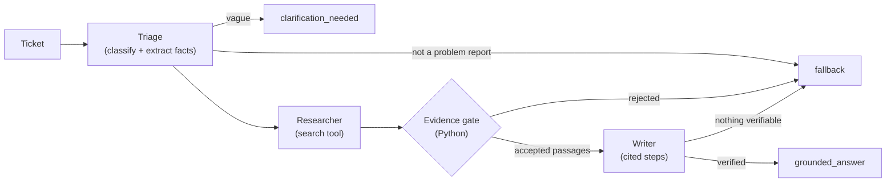

# Agentic Technical Support (RAG)

A multi-agent support assistant for IT tickets. It classifies a ticket, searches a small internal documentation base, and returns troubleshooting steps **only when retrieved documentation supports them**. When the ticket is too vague it asks clarifying questions, and when the documentation cannot support an answer it returns a fixed, application-owned fallback instead of guessing.

**Intended use:** a demonstration and evaluation project, run on a fixed ticket set against a 14-document corpus. Results on that set show the designed behaviors work for those cases; they do **not** establish production reliability.

**Highlights**

- Three Gemini agents (Triage, Researcher, Writer), orchestrated by a **Python Coordinator** that owns all control flow. The agents never call each other or act on their own.
- A deterministic **evidence gate** decides whether the Writer runs at all. It is a heuristic retrieval filter: its thresholds were calibrated on ticket text, not on the queries it now scores (see [Limitations](#limitations-quota-and-security)).
- Each step the Writer returns must appear word for word (ignoring whitespace) in the passage it cites, and so must its supporting quote. The host checks this in Python and drops any step that fails. The short summary is checked more loosely: it may not introduce filenames, numbers, commands, or destructive actions absent from the passages.
- An evaluation harness that separates passes, failures, infrastructure errors, and unexecuted tickets, and records provider-reported token usage.
- Request IDs, structured stage logs, and secret redaction, with no external monitoring service.

## How it works



| Part | Role |
|---|---|
| **Coordinator** (Python) | Runs each stage at most once, validates every hand-off, applies timeouts, builds the response |
| **Triage** (Gemini) | Category plus completeness facts: is it a troubleshooting request, which system, which symptom |
| **Clarification policy** (Python) | Asks the reporter for detail when no observable symptom was stated; no search is run |
| **Researcher** (Gemini) | Decides whether to search and writes the query; the host executes `search_technical_documentation` once |
| **Evidence gate** (Python) | Accepts passages only if the best match is close enough and stands out from unrelated documents |
| **Writer** (Gemini) | Writes steps from accepted passages only; unsupported steps are dropped |

Details, a sequence diagram, the gate's limits, and error handling are in [docs/ARCHITECTURE.md](docs/ARCHITECTURE.md).

### Outcomes

| `outcome` | Meaning |
|---|---|
| `grounded_answer` | Recommendations with cited `sources`; `sufficient_evidence: true` |
| `clarification_needed` | `clarifying_questions`, no recommendations, no search |
| `fallback` | The fixed message *"Insufficient supporting documentation was found to provide reliable troubleshooting recommendations. Please review the ticket manually."* |

Example request and the clarification response (the questions and summary are fixed strings; `category` comes from the model):

```http
POST /tickets/analyze
Content-Type: application/json

{"ticket_id": "T-VAGUE-001", "description": "It stopped working after yesterday."}
```

```json
{
  "ticket_id": "T-VAGUE-001",
  "category": "application",
  "outcome": "clarification_needed",
  "clarifying_questions": [
    "Which system or feature is affected (for example the website, sign-in, VPN, file uploads, or a specific database)?",
    "What exactly happens? Please include the exact error message or code, or describe what you see instead of the expected result.",
    "When did it start, and is it affecting one user, a team, or everyone?"
  ],
  "recommendations": [],
  "sources": [],
  "sufficient_evidence": false,
  "fallback_triggered": false,
  "summary": "More detail is needed before documented troubleshooting steps can be recommended. Please answer the questions below."
}
```

## Results

A single live run on the 20-ticket held-out set, from 2026-10-26, using `gemini-3.5-flash-lite` with `gemini-embedding-001`. Full report: [evaluation/results/RESULTS.md](evaluation/results/RESULTS.md).

| Measure | Result |
|---|---|
| Tickets passed / failed / infrastructure error | 18 / 1 / 1 |
| Final outcome (scored tickets) | 18/19 |
| Tool selection | 19/19 |
| Citation correctness (grounded answers) | 8/8 |
| Gemini calls (incl. retries) / embedding requests | 46 / 14 |
| Tokens, provider-reported (input / output) | 22,143 / 5,697 |
| Latency p50 | 3.2 s |
| Estimated cost | not estimated (no prices supplied) |

The failed ticket (E-REL-005) fell back although relevant documents were found. The infrastructure error (E-REL-006) was a per-minute rate limit that outlasted the stage timeout. Citation correctness checks *which* documents are cited, not whether each sentence is faithful; sentence-level support is enforced at runtime by the Writer check above and is not scored separately. A single run of 20 tickets cannot show run-to-run variance. Earlier runs and their caveats are in [docs/ARCHITECTURE.md](docs/ARCHITECTURE.md#measured-results).

## Quick start

Requires Python 3.12 (the version the Docker image and local runs use) and a Gemini API key from [Google AI Studio](https://aistudio.google.com/apikey).

```bash
python -m venv .venv
.venv\Scripts\activate          # Windows
# source .venv/bin/activate     # macOS/Linux
pip install -r requirements.txt
copy .env.example .env          # or: cp .env.example .env
```

Set your key in `.env`. The example file already selects the demo model:

```env
GOOGLE_API_KEY=your_api_key_here
LLM_MODEL=gemini-3.5-flash-lite
```

Build the local index, then start the API:

```bash
python -m app.retrieval.ingestion     # embeds data/technical_docs/ into data/chroma/ (re-embeds all 14 docs each run)
uvicorn app.main:app --reload
```

- API docs: http://127.0.0.1:8000/docs
- Endpoints: `POST /tickets/analyze`, `GET /health`. Every response carries an `X-Request-ID` header.
- Browser console: see [frontend/README.md](frontend/README.md).
- One-off run from the command line: `python -m app.orchestration.coordinator`. This makes live Gemini calls.

### Docker

```bash
docker compose up --build
```

This serves the console at http://localhost:8080 and the API at http://127.0.0.1:8000/docs. The key is read from `.env` at runtime and is not built into the images. The first start embeds the docs into a Docker volume; later starts skip ingestion while that index exists. To rebuild the index:

```bash
docker compose run --rm --no-deps --entrypoint python api -m app.retrieval.ingestion
```

### Configuration

Settings live in `app/config.py` and can be overridden by environment variables or `.env`, using the upper-case field name.

| Variable | Default | Meaning |
|---|---|---|
| `GOOGLE_API_KEY` | none | Gemini API key (required) |
| `LLM_MODEL` | `gemini-3.8-flash` (`.env.example` sets `gemini-3.5-flash-lite`) | Model for all three agents |
| `EMBEDDING_MODEL` | `gemini-embedding-001` | Embeddings for ingestion and search |
| `RETRIEVAL_TOP_K` | `5` | Chunks returned per search |
| `RELEVANCE_MAX_DISTANCE` / `RELEVANCE_MIN_CONTRAST` / `RELEVANCE_CONTRAST_RANK` | `0.3687` / `0.0442` / `5` | Calibrated evidence-gate thresholds |
| `MODEL_CALL_TIMEOUT_SECONDS` / `TOOL_EXECUTION_TIMEOUT_SECONDS` | `45` / `20` | Per-call bounds |

The two model values differ on purpose. Without `LLM_MODEL`, the code uses `gemini-3.8-flash`. `.env.example` overrides it with `gemini-3.5-flash-lite` because, as its comment notes, `gemini-3.8-flash` is limited to about 20 free requests per day. All results above were measured with `gemini-3.5-flash-lite`.

## Tests and evaluation

**Offline tests** (deterministic; models and retrieval are faked, no API calls):

```bash
pytest tests -q
```

**Live tests** are marked `live` and run only when you opt in:

```bash
RUN_LIVE_TESTS=1 pytest tests -m live -q      # bash; also needs GOOGLE_API_KEY
# PowerShell: $env:RUN_LIVE_TESTS="1"; pytest tests -m live -q
```

**Live evaluation** (calls Gemini; about 46 generation and 14 embedding requests for the 20 tickets):

```bash
python -m evaluation.run_evaluation                                   # 20-ticket held-out set
python -m evaluation.run_evaluation --ticket-id E-REL-004             # one ticket
python -m evaluation.run_evaluation --baseline evaluation/results/perf_baseline.json   # compare on the same tickets
python -m evaluation.run_evaluation --dataset evaluation/regression_tickets.json      # regression set, reported separately
python -m evaluation.run_evaluation --rescore                         # offline: re-score saved traces
```

- **Ticket status.** Each ticket is `passed`, `failed`, `infrastructure_error`, or `not_executed`. Only `passed` counts.
- **Partial runs.** Results are saved after every ticket, and a run stopped by quota is marked incomplete and lists the tickets it did not run.
- **Cost.** It is estimated only when you pass `--input-usd-per-mtok` and `--output-usd-per-mtok`.

**Data separation.** The gate thresholds are fitted on `evaluation/calibration_tickets.json` (53 labeled tickets). Those tickets share no IDs or text with the 20-ticket evaluation set, and the runner refuses to evaluate the calibration file. Expected labels are never edited to match the system.

```bash
python -m evaluation.calibrate_relevance                    # live: embeds the calibration tickets and fits
python -m evaluation.calibrate_relevance --reuse-features   # offline: refit from saved scores
```

## Limitations, quota, and security

- **Small corpus.** 14 Markdown documents, and a 20-ticket evaluation from single runs. Treat the results as evidence the mechanism works, not as a reliability figure.
- **Clarification hinges on one Triage call.** The known regression E-REL-004 ("cannot resolve internal hostnames…") has been wrongly sent to clarification in some runs.
- **Gate calibration mismatch.** The gate's thresholds were calibrated on ticket-text scores but now score the Researcher's query. Passing the gate means the passages are close to the query, not that the answer is correct.
- **Local, trusted use only.** The API has no authentication, rate limiting, or request-size limit on ticket fields, and clarification is single-turn. Add these before handling real tickets.
- **Prompt injection.** A few unit tests check that injected instructions in tickets and passages cannot change an agent's role, tool call, or citations. There is no adversarial evaluation, so this is not a robustness claim.
- **Quota.** Free-tier Gemini quotas are small. Evaluation runs have hit per-minute 429s and the daily cap, and `.env.example` warns that the code-default model allows very few free requests per day.
- **Security.**
  - Keys are never logged; log records are redacted.
  - Keys are not built into images, and `.env` is git-ignored.
  - Client errors carry fixed messages only.
  - Ticket text and passages are treated as data, and citations and tool calls are checked in Python.

More detail, and the list of planned improvements, is in [docs/ARCHITECTURE.md](docs/ARCHITECTURE.md#limitations).

## Project layout

```text
app/
  main.py                 FastAPI app: POST /tickets/analyze, GET /health
  orchestration/          workflow.py (Coordinator), coordinator.py (traces, entry points), model.py (Gemini calls, retries)
  agents/                 triage.py, researcher.py, writer.py, state.py (shared run state)
  policies/               clarification.py, evidence.py (evidence gate)
  retrieval/              ingestion.py, retrieval.py (ChromaDB)
  tools/knowledge_base.py search tool definition
  observability.py        request IDs, stage events, redaction
  usage.py                per-request call and token counters
  config.py, schemas.py
data/technical_docs/      the 14-document knowledge base
docs/ARCHITECTURE.md      design, limits, measured results
evaluation/               datasets, run_evaluation.py, scoring.py, calibrate_relevance.py, results/
frontend/                 browser console
tests/                    offline tests (+ opt-in live tests)
```

`app/agent.py`, `app/clarification.py`, and `app/rag/` are compatibility wrappers around the modules above.

## Publishing notes

Keep real keys only in your local `.env`. The repository ships `.env.example` with a placeholder.
