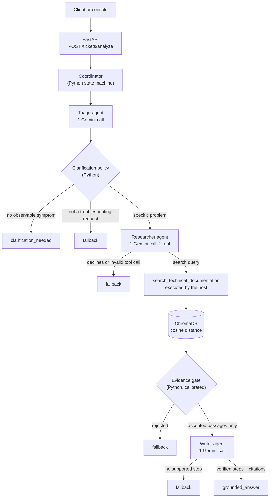
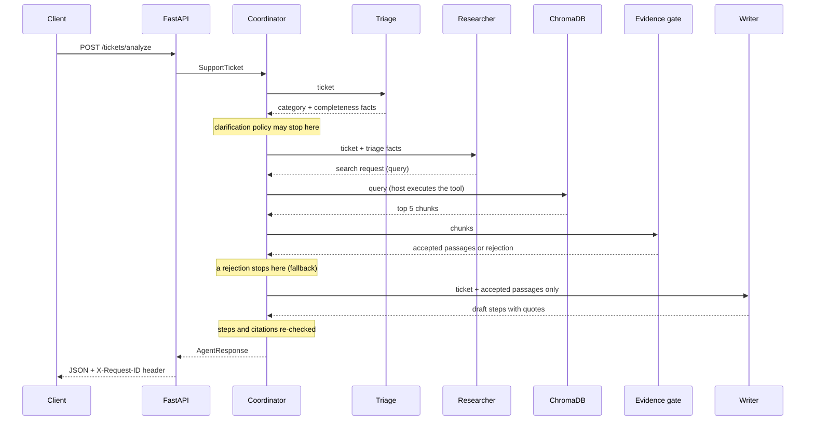

# Architecture

How the support pipeline is built, what each part is responsible for, and where its limits are. The [README](../README.md) covers setup and the headline results.

## Components

| Component | Code | Responsibility | Model calls |
|---|---|---|---|
| **Coordinator** | `app/orchestration/workflow.py` | Python state machine. The only owner of control flow: runs each agent at most once, validates every hand-off, applies timeouts, builds the response. Agents never call each other. | none |
| **Triage** | `app/agents/triage.py` | Classifies the ticket (`network`, `database`, `authentication`, `application`, `other`) and extracts completeness facts: is it a troubleshooting request, which system, which observable symptom. | 1 (structured JSON) |
| **Clarification policy** | `app/policies/clarification.py` | Python. Decides whether to ask the reporter for detail, from the Triage facts. | none |
| **Researcher** | `app/agents/researcher.py` | Decides whether to search and writes the search query. It is offered exactly one tool, `search_technical_documentation(query)`. The host validates the call (tool name, a single `query` argument of at most 500 characters) and executes it at most once. | 1 (function calling) |
| **Retrieval** | `app/retrieval/retrieval.py` | Embeds the query with `gemini-embedding-001` and returns the `retrieval_top_k` (default 5) closest chunks from the local ChromaDB collection (cosine distance). | 1 embedding request |
| **Evidence gate** | `app/policies/evidence.py` | Python. Accepts or rejects the retrieved passages using calibrated thresholds. Only accepted passages may reach the Writer. | none |
| **Writer** | `app/agents/writer.py` | Writes troubleshooting steps from the accepted passages only. Each step must cite a supplied source and include a quote; the host keeps a step only if its text and quote occur in that passage. | 1 (structured JSON) |
| **API** | `app/main.py` | FastAPI: `POST /tickets/analyze`, `GET /health`. Maps failures to fixed client messages and status codes. | none |

Older entry points (`app/agent.py`, `app/clarification.py`, `app/rag/*`) are compatibility wrappers that re-export from the modules above.

## Flow





Early exits are enforced and tested: clarification and non-troubleshooting tickets make one Gemini call and no search; a rejected or empty retrieval never calls the Writer.

## The three outcomes

| `outcome` | When | Payload |
|---|---|---|
| `grounded_answer` | The gate accepted evidence and the Writer produced at least one verified step | `recommendations`, cited `sources`, `sufficient_evidence: true` |
| `clarification_needed` | A troubleshooting ticket with no observable symptom | `clarifying_questions`, no recommendations, no search |
| `fallback` | Not a troubleshooting request, no search, evidence rejected, or no supported step | The fixed message below, `fallback_triggered: true` |

> Insufficient supporting documentation was found to provide reliable troubleshooting recommendations. Please review the ticket manually.

Clarification and fallback are different gaps: clarification means the reporter has not said what happens; fallback means the documentation cannot support an answer.

## Clarification policy

Triage only *extracts* phrases. Python decides (`decide_clarification`): a troubleshooting ticket needs clarification unless the extracted symptom has at least one specific word and every word of it appears in the ticket. Generic words ("broken", "errors", "not working", "loads", …) and words that only repeat the system name do not count, so paraphrased or invented extractions are ignored.

The earlier single-agent pipeline ran a second embedding check before asking for clarification (`check_ticket_specificity` in `app/orchestration/coordinator.py`). The multi-agent workflow does **not** call it, so a symptom that Triage fails to extract leads to clarification. This is the cause of the E-REL-004 regression (see Limitations).

## Evidence gate

```text
best     = cosine distance of the closest retrieved document
contrast = distance of the 5th closest distinct document - best

accepted = retrieval ran
           and best <= relevance_max_distance   (0.3687)
           and contrast >= relevance_min_contrast (0.0442)
```

- Distance rejects out-of-corpus tickets, which land on unrelated pages at larger distances.
- Contrast rejects vague tickets, which sit close to many documents at once without one standing out.
- Not searching is never treated as sufficient evidence.
- Each decision has a reason code: `accepted`, `no_retrieval`, `empty_retrieval`, `distance_above_threshold`, `too_few_documents_for_contrast`, `low_contrast`, `retrieval_failed`.

**What the gate does not establish.** Passing the gate means the passages are *close to the query in embedding space*. It does not show that they answer the ticket, and it does not check the Writer's text. Faithfulness relies on the Writer's verbatim-quote check, which is a string check, not a semantic one.

**Calibration vs use.** The thresholds were fitted by `evaluation/calibrate_relevance.py` on scores for the *original ticket text* with a 15-candidate pool. In the multi-agent pipeline the gate scores the *Researcher's query* with 5 results. A model-written query can add domain words the ticket never contained, so the calibrated error rates do not carry over exactly. The thresholds were not re-fitted for this setup.

## Timeouts, retries, and errors

| Bound | Default | Setting |
|---|---|---|
| One model call | 45 s | `MODEL_CALL_TIMEOUT_SECONDS` |
| One tool execution | 20 s | `TOOL_EXECUTION_TIMEOUT_SECONDS` |
| Researcher stage | 65 s (model + tool) | derived |

- The Coordinator never retries a timed-out stage. The shared Gemini helper (`app/orchestration/model.py`) retries transient errors (per-minute 429, 500, 503) up to 5 attempts. A retry whose wait would pass the stage deadline is not attempted: the original error is raised (for a 429, the request fails as `rate_limited`), so an abandoned worker does not keep calling Gemini. The daily quota is not retried.
- A Gemini 4xx other than 429 is a defect in the request, not an outage. In the Researcher and Writer stages it fails the request as a workflow error; from Triage it surfaces as an HTTP 400/502.
- A retrieval error ends in `fallback` with no Writer call.
- Client responses use fixed messages: 400 (bad request or missing key), 429 (rate limit, with the retry delay only), 502/503 (upstream or analysis failure), 500 (unexpected). Exception text and upstream messages stay in the server log.
- One `google-genai` client is built per API key and reused (`get_genai_client`). It holds no ticket data, and its HTTP requests time out after `MODEL_CALL_TIMEOUT_SECONDS`, so a worker abandoned by a stage timeout still ends.

## Observability

`app/observability.py` extends the standard `logging` module; there is no external service.

- **Request ID.** Bound per request in a context variable, carried into agent worker threads, and returned as the `X-Request-ID` header. A caller may send a plain ID of up to 64 characters; anything else is replaced.
- **Events.** One `event=stage` line per stage and one `event=request` line per request on the `app.events` logger. They hold the stage, status, measured duration, model calls, retries, tool executions, retrieval count, gate decision and reason code, outcome, error category, and provider-reported tokens. Tokens are omitted (`tokens=not_reported`) when Gemini returned no usage metadata.
- **Content.** Events never contain ticket text, passages, or prompts.
- **Redaction.** Every log record is redacted when created, including tracebacks: Google API keys, bearer tokens, `api_key`/`password`/`key=` style values, and the configured key. Line breaks in logged string arguments are escaped, so a user-supplied value such as a ticket ID cannot forge log lines.
- **Gap.** Non-event log lines carry `request_id` as a record attribute, but the default format does not print it; add `%(request_id)s` to the log format to see it.

## Evaluation method

- **Datasets.**
  - `evaluation/support_tickets.json` (v1.1, 20 tickets) is the held-out evaluation set: 10 `grounded_answer`, 7 `fallback`, 3 `clarification_needed`.
  - `evaluation/regression_tickets.json` (16 tickets) is scored separately, so the original 20 stay comparable.
  - `evaluation/calibration_tickets.json` (53 tickets) is used only to fit the gate. The runner refuses it as an evaluation set; it shares no ticket IDs or text with the other two.
- **Labels.** Expected labels are never edited to match the system.
- **Ticket status.** Each ticket ends in exactly one of `passed`, `failed`, `infrastructure_error`, or `not_executed`. Only `passed` counts, and the headline rate is over all selected tickets. Model, network, quota, and retrieval failures are infrastructure errors. Anything unexplained counts as a system failure.
- **Partial runs.** Results are saved after every ticket. A run stopped by the daily quota or an interrupt is marked incomplete and lists the tickets it did not run.
- **Scored behaviors.**
  - final outcome
  - tool selection
  - citation correctness: every cited document was accepted evidence, and one is an expected supporting document
  - an evidence-gate diagnostic (not part of the ticket pass)
- **Also recorded.** Model calls, retrieval executions, latency percentiles, and provider-reported tokens. Cost is estimated only if you pass prices on the command line.
- **Comparison.** `--baseline <report.json>` compares two runs on tickets with identical text, re-scoring both with the current scorer.

## Measured results

All runs: live, `gemini-3.5-flash-lite`, `gemini-embedding-001`, the 20-ticket set, on 2026-10-25/26.

| Run | Passed / failed / infra error | Outcome | Tool selection | Citations | Gemini calls | Input / output tokens | Latency p50 / p95 |
|---|---|---:|---:|---:|---:|---:|---:|
| Single-agent baseline (`before_specificity_check.json`), re-scored | 19 / 1 / 0 | 19/20 | 19/20 | 9/9 | not recorded | not recorded | 10.3 s / 30.9 s |
| Multi-agent, before client reuse (`perf_baseline.json`) | 18 / 2 / 0 | 18/20 | 19/20 | 8/8 | 44 | 22,351 / 5,366 | 10.0 s / 21.1 s |
| Multi-agent, current (`RESULTS.md`, `perf_after_client_reuse.json`) | 18 / 1 / 1 | 18/19 | 19/19 | 8/8 | 46 | 22,143 / 5,697 | 3.2 s / 48.7 s |

- The evidence-gate diagnostic was 14/14 in both multi-agent runs.
- Tokens are Gemini `usage_metadata`; every response reported usage. No thinking tokens were reported. Cost was not estimated.
- In the current run, average latency by outcome was 4.1 s for a grounded answer and 0.8 s for clarification; p95 includes one timed-out ticket.
- Not passed in the current run:
  - E-REL-005: the gate accepted two relevant documents, but the Writer produced no verifiable step, so it fell back.
  - E-REL-006: per-minute 429 retries ran past the Researcher's 65 s bound; counted as an infrastructure error, not a pass.
- E-REL-004 failed in the earlier multi-agent run (Triage missed the symptom) and passed in the current one. Triage is not deterministic, so this is not a fix.
- The single-agent row is a different pipeline, not a like-for-like model configuration test of one change.

Other measured artifacts:

- `evaluation/results/CALIBRATION.md`: gate thresholds fitted on the 53 calibration tickets.
- `evaluation/results/CLARIFICATION_CHECK.md`: 51/53, measured with the **legacy** single-agent classifier (`classify_ticket`), not the current Triage agent.
- `evaluation/results/BEFORE_WRITER_SCHEMA_FIX.md`: a multi-agent run in which every Writer call failed with HTTP 400 (an unsupported response schema). Fixed since, and covered by a test.
- The regression set has not been run against the multi-agent pipeline.

## Limitations

- **Small corpus.** 14 curated Markdown documents, one chunk each. The gate's contrast check assumes one document owns each topic.
- **Clarification depends on one model call.** E-REL-004 shows Triage can miss a stated symptom; the old second check is no longer used.
- **Gate calibration mismatch.** See [Evidence gate](#evidence-gate).
- **Writer strictness.** Verbatim matching can reject valid answers (E-REL-005).
- **Single turn.** The API returns clarifying questions, but the reporter's answer must be sent as a new ticket.
- **No API authentication, rate limiting, or multi-tenant isolation.** The API is demo-grade.
- **Ingestion re-embeds everything.** `python -m app.retrieval.ingestion` re-embeds and upserts every document on each run. The Docker start script skips ingestion only when the collection is non-empty.
- **Quota.** A full 20-ticket run used 44–46 generation calls and 14 embedding calls. Runs have been stopped by the daily quota, and faster requests hit per-minute 429s. `.env.example` notes that `gemini-3.8-flash` (the code default) allows far fewer free requests per day than `gemini-3.5-flash-lite`.
- **Small evaluation set.** 20 tickets show behavior on that set; they are not a reliability claim.

## Security measures

- The API key is read from `.env` or the environment. It is not written into Docker images, is never logged (redaction), and `.env` is git-ignored. `.env.example` contains a placeholder only.
- Ticket text and retrieved passages are passed to every agent as data. Prompts say instructions inside them do not apply, and the host enforces what matters: an agent's tool name and arguments, citations, and verbatim support are checked in Python.
- The Writer sees only gate-accepted passages. A destructive step is kept only if its quote contains the step and its precaution.
- Client error bodies never include exception text, upstream messages, or stack traces.

## Planned (not implemented)

- Re-fit the gate thresholds on Researcher-query scores, or have the gate score the original ticket text again.
- Restore a second opinion before clarification, or make symptom extraction more robust; then re-measure E-REL-004 over repeated runs.
- Run the regression set against the multi-agent pipeline.
- Report multi-run variance instead of single runs.
- Skip unchanged documents during ingestion.
- Authentication and rate limiting for the API; conversation state for clarification follow-ups.
